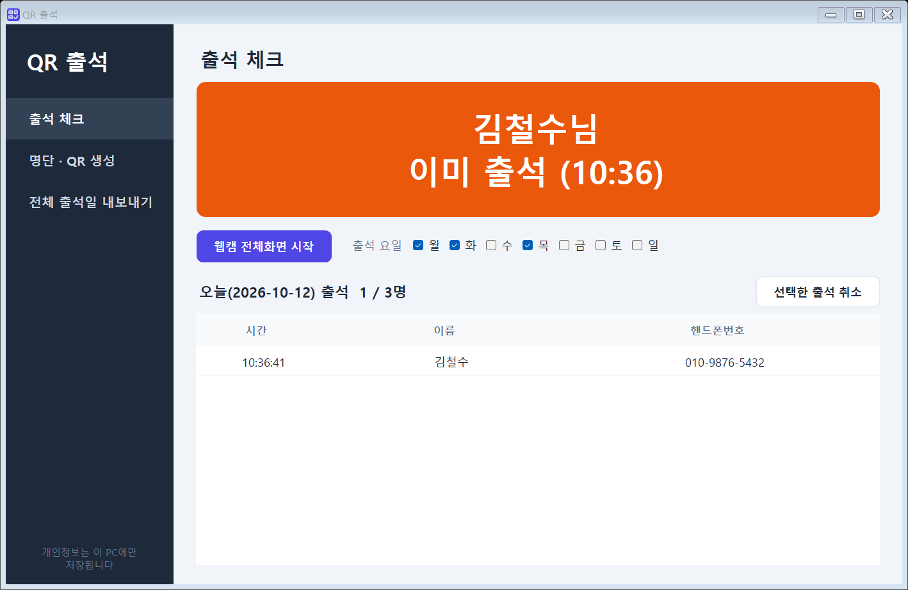
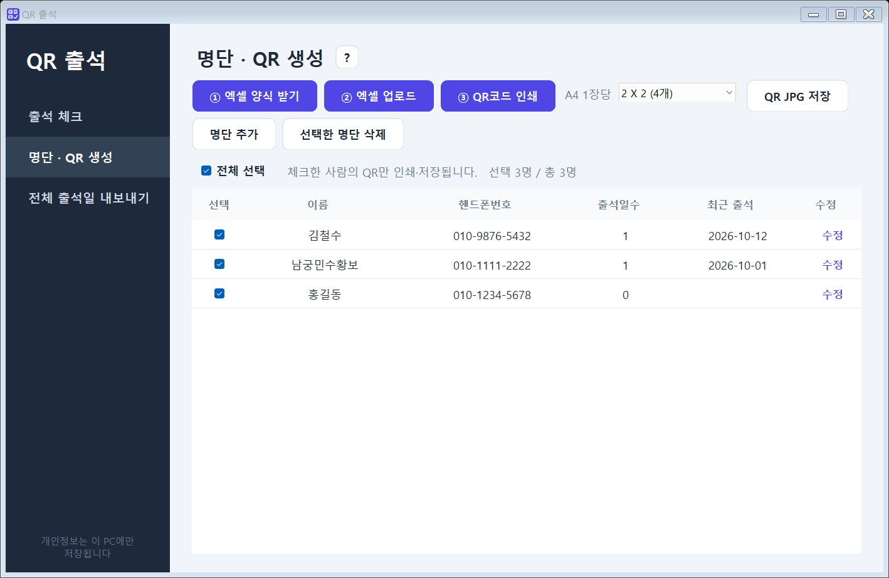
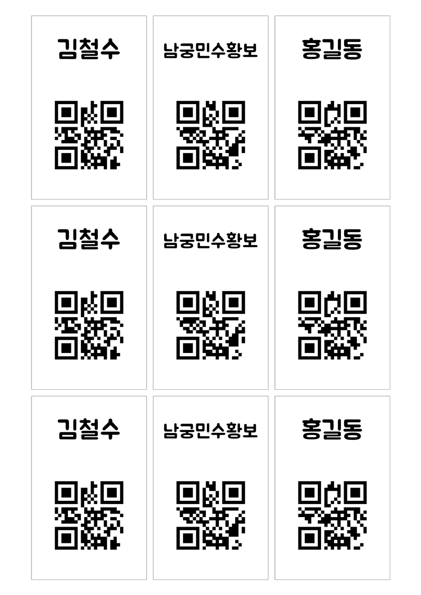

# QR 출석

엑셀 명단으로 개인별 QR코드를 만들고, 웹캠에 QR을 비춰 출석을 기록하는 Windows 데스크톱 프로그램입니다.
이름·핸드폰번호 같은 개인정보가 **PC 밖으로 나가지 않도록** 서버 없이 한 대의 PC 안에서만 동작합니다.



## 주요 기능

- **명단 업로드** — 엑셀(이름 + 핸드폰번호) 양식을 내려받아 채운 뒤 업로드하면 사람마다 QR이 만들어집니다. 같은 사람을 다시 올려도 중복 등록되지 않고 기존 QR이 유지됩니다.
- **명단 추가 · 수정 · 삭제** — 한 명씩 직접 등록하거나 이름·번호를 고칠 수 있습니다. 수정해도 QR은 바뀌지 않으며, 삭제하면 그 사람의 출석 기록도 함께 지워집니다.
- **QR코드 인쇄** — A4 한 장에 2×2 / 3×3 / 4×4 배치로 인쇄합니다. 체크한 사람만 골라 인쇄할 수 있습니다.
- **QR JPG 저장** — 핸드폰에 넣어 쓸 수 있게 사람별 JPG 파일로 저장합니다.
- **웹캠 출석 체크** — 전체화면 웹캠에 QR을 비추면 출석이 기록됩니다. 가운데 맞춤 가이드와 결과 표시(출석 완료 / 이미 출석 / 미등록 QR)가 나옵니다.
- **출석 요일 설정** — 출석을 받는 요일을 지정하면 그 요일에만 출석이 기록됩니다. 한 번 정하면 계속 유지됩니다.
- **출석 취소** — 오늘 출석 기록을 선택해 취소할 수 있습니다.
- **전체 출석일 내보내기** — 기간을 정해 엑셀로 내보냅니다. 이름이 행, 날짜가 열이며 출석한 날은 출석 시간, 안 한 날은 `-`로 표시됩니다.

| 명단 · QR 생성 | QR코드 인쇄 (3×3) |
|---|---|
|  |  |

화면의 이름과 번호는 모두 테스트용 가상 데이터입니다.

## 개인정보를 다루는 방식

- 네트워크 통신 코드가 없습니다. 데이터는 실행 파일 옆 `data\attendance.db`(SQLite) 한 곳에만 저장됩니다.
- QR 안에는 이름이나 번호가 아니라 **무작위 10자리 숫자**만 들어갑니다. QR이 유출되어도 개인정보를 알 수 없습니다.
- 사람은 `이름 + 핸드폰번호`로 구분하므로 동명이인도 따로 등록됩니다.
- 출석은 한 사람당 하루 한 번만 기록됩니다(DB의 `UNIQUE(person_id, day)` 제약).

## 기술 스택

| 구분 | 사용 기술 |
|---|---|
| 언어 / 런타임 | C# · .NET 8 |
| UI | Windows Forms (디자이너 없이 코드로 구성, 직접 그린 버튼·배너·스캔 가이드) |
| 저장소 | SQLite (`Microsoft.Data.Sqlite`) |
| 엑셀 | ClosedXML |
| 웹캠 · QR 인식 | OpenCvSharp4 (`VideoCapture`, `QRCodeDetector`) |
| QR 생성 | QRCoder |
| 인쇄 | `PrintDocument` + `PrintPreviewDialog` |

## 구조

| 파일 | 역할 |
|---|---|
| `Program.cs` | 진입점, 자체 점검(`--selftest`) |
| `Core.cs` | DB, 엑셀 가져오기·내보내기, QR 카드 이미지 생성 |
| `Camera.cs` | 백그라운드 스레드에서 웹캠 프레임 수집과 QR 인식 |
| `MainForm.cs` | 화면 3개(출석 체크 / 명단·QR 생성 / 전체 출석일 내보내기), 인쇄 배치 |
| `Ui.cs` | 색상 팔레트와 둥근 버튼·라벨 컨트롤 |

## 빌드와 실행

Windows 10/11 (x64)과 .NET 8 SDK가 필요합니다.

```powershell
dotnet run
```

런타임 설치 없이 다른 PC에서 실행할 단일 exe 만들기:

```powershell
dotnet publish -c Release -r win-x64 --self-contained true -p:PublishSingleFile=true -p:IncludeNativeLibrariesForSelfExtract=true -p:EnableCompressionInSingleFile=true -o dist
```

만들어진 `dist\QR출석.exe` 파일 하나만 옮기면 됩니다.

## 자체 점검

```powershell
dist\QR출석.exe --selftest <빈 폴더>
```

임시 DB로 명단 가져오기 → QR 생성·인식 → 출석 기록 → 엑셀 내보내기를 한 번에 돌리고, 결과(`result.txt`)와 화면 캡처를 해당 폴더에 남깁니다.

## 라이선스 표기

QR 카드의 글꼴은 [Jua](https://fonts.google.com/specimen/Jua)이며 SIL Open Font License를 따릅니다(`fonts/Jua-OFL.txt`).
